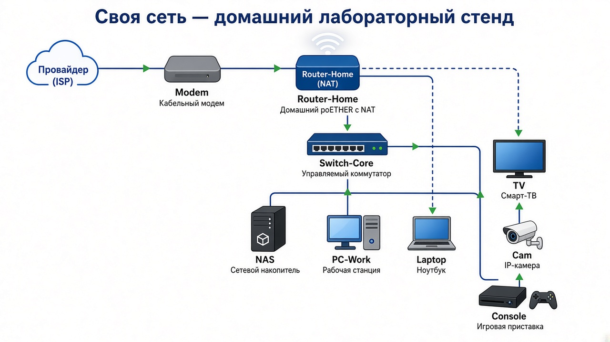
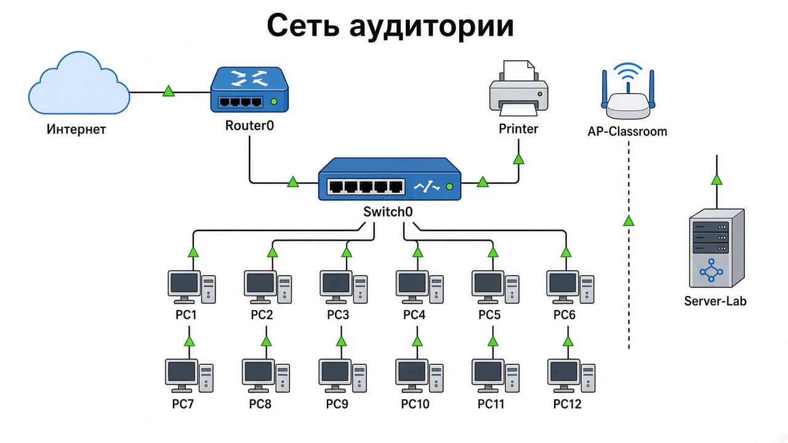

# Домашнее задание №1

Нужно было придумать сеть, которую хотелось бы построить, и нарисовать в draw.io схему сети аудитории.

## Своя сеть

Домашний лабораторный стенд: провайдер → модем → роутер с NAT → коммутатор, к нему NAS, рабочие ПК, камера и медиаустройства, плюс Wi‑Fi для ноутбука и ТВ.

[Исходник draw.io](../../.github/assets/lesson_01/home-lab-network.drawio)

## Сеть аудитории

Учебная аудитория: интернет → Router0 → Switch0 → компьютеры PC1–PC12, принтер, сервер лаборатории и точка доступа Wi‑Fi.

[Исходник draw.io](../../.github/assets/lesson_01/classroom-network.drawio)
