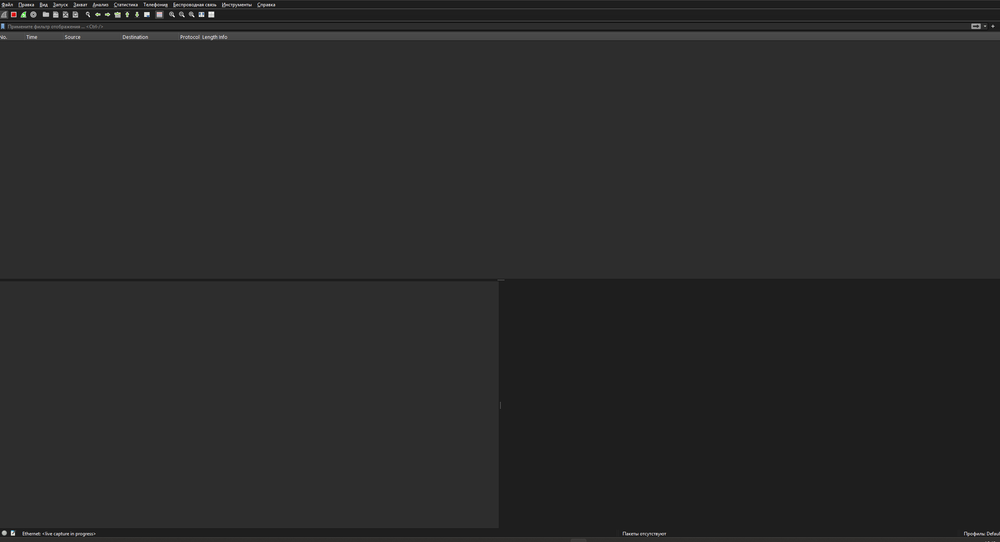
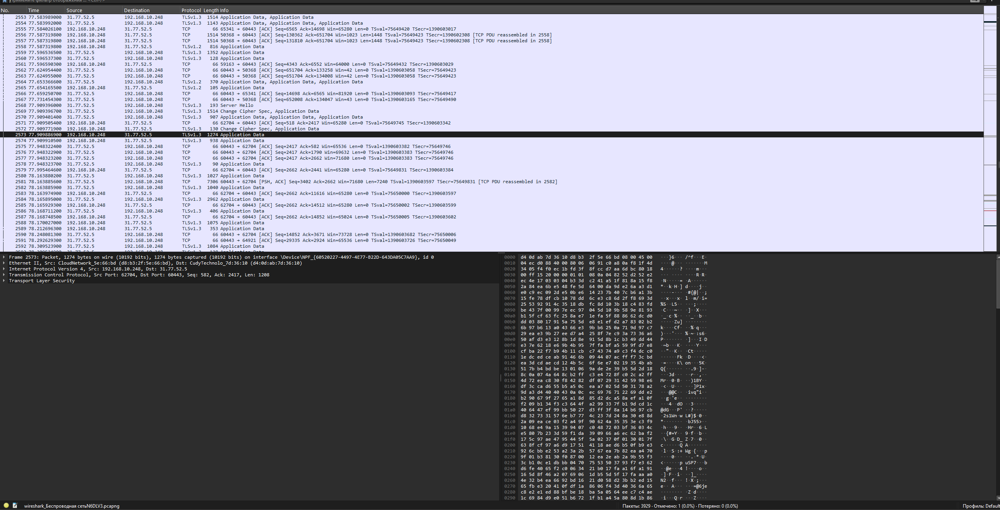

# Домашнее задание №2

Нужно было запустить Wireshark и записать Ethernet-трафик.

Сначала я выбрал Ethernet, но пакеты не появились. Компьютер был подключён к сети через Wi-Fi, поэтому захват на Ethernet-интерфейсе оказался пустым.

После выбора беспроводного интерфейса трафик появился.

