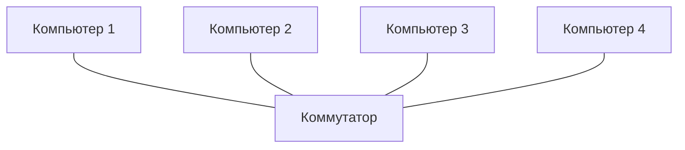

# Домашнее задание №3

## Схема MAC-адреса

[Открыть исходник draw.io](../../.github/assets/lesson_03/MAC-адрес.drawio)

## Подключение компьютеров к коммутатору

## Возможные проблемы

| Ситуация | Причина | Что проверить |
| --- | --- | --- |
| Индикатор порта не горит | Повреждён кабель, порт или сетевая карта | Переподключить кабель, проверить порт и сетевую карту |
| Компьютеры не видят друг друга | Устройства находятся в разных подсетях или VLAN | Проверить IP-адреса, маски и настройки VLAN |
| Сеть работает медленно | Не совпадают скорость или режим дуплекса | Включить автоопределение или выставить одинаковые параметры |
