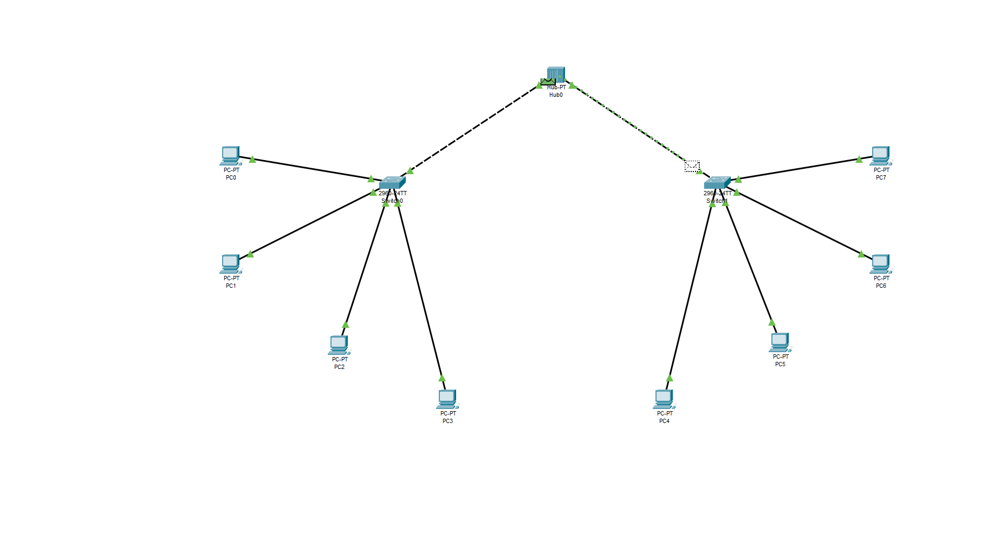

# Домашнее задание №6

Нужно было собрать сеть из 8 компьютеров, 2 коммутаторов и 1 хаба.

## Схема сети

## Проверка ping

## Работа в режиме симуляции

[Файл Packet Tracer](../../.github/pkt/lesson_06/topology_8pc_2switch_1hub.pkt)
