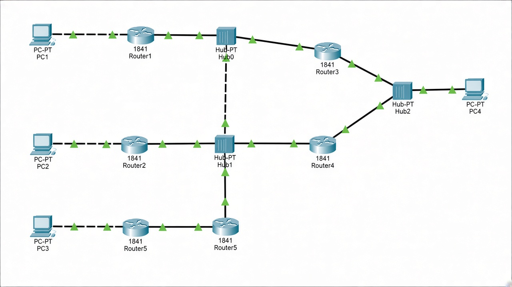

# Домашнее задание №9

Нужно было настроить RIP на третьей схеме из презентации и прислать скрин, где все соединения активны и горят зелёным.

## Результат

В Cisco Packet Tracer собрана схема, на маршрутизаторах поднят RIP, линки между устройствами подняты — индикаторы зелёные.

[Файл Packet Tracer](../../.github/pkt/lesson_08/Сеть-для-настройки-RIP.pkt)
