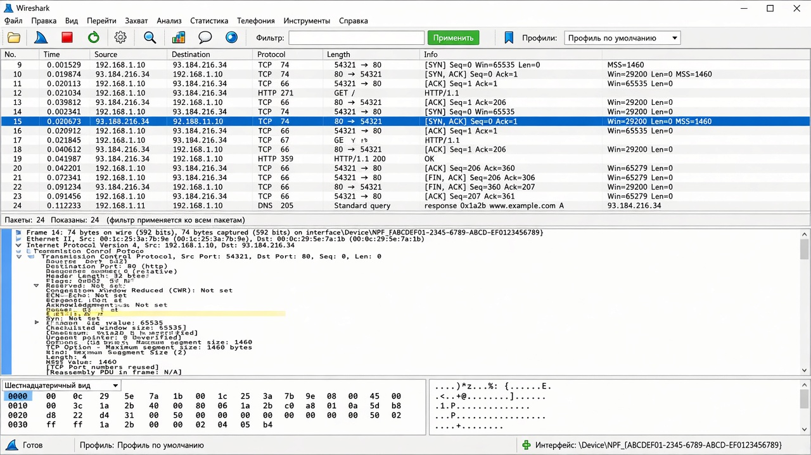
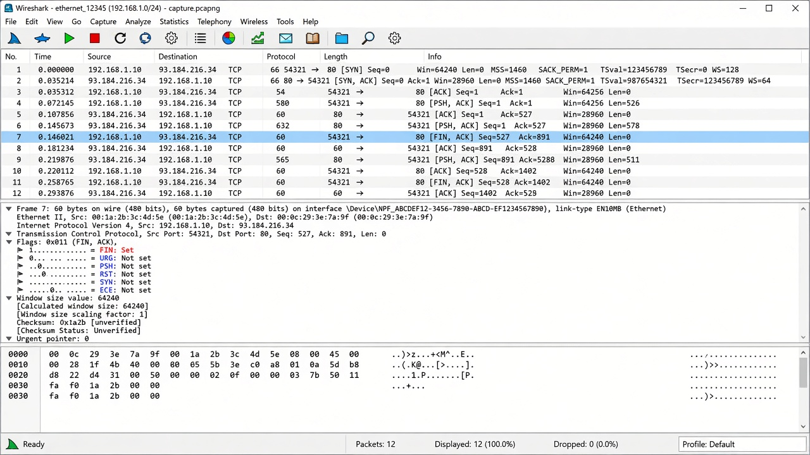
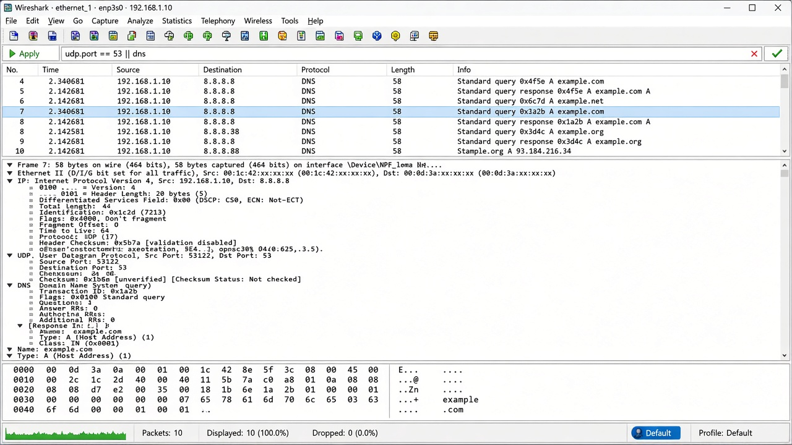

# Домашнее задание №11

## Краткая выжимка

Транспортный уровень передаёт данные между приложениями на разных устройствах. Для выбора нужной программы используются номера портов. UDP отправляет дейтаграммы без установки соединения и не проверяет, дошли ли они до получателя. Из-за небольшого заголовка UDP подходит для DNS, голосовой связи, игр и потокового видео. TCP передаёт поток данных с установлением соединения и контролем доставки. Перед началом обмена TCP выполняет трёхэтапное рукопожатие с флагами SYN и ACK. Порядок данных определяется номерами последовательности, а получение подтверждается ответами ACK. Если сегмент потерялся, TCP отправляет его повторно. Скользящее окно позволяет не ждать подтверждения после каждого сегмента. Управление потоком и перегрузкой не даёт переполнить получателя и слишком сильно нагрузить сеть.

## Скриншоты Wireshark

По заданию нужны 3 скриншота: два TCP с разными флагами и один UDP.

### 1. TCP — флаг SYN

Начало соединения: клиент отправляет сегмент с флагом `SYN`.

### 2. TCP — флаги FIN, ACK

Закрытие соединения: сегмент с флагами `FIN` и `ACK`.

### 3. UDP — DNS-запрос

UDP-пакет на порт 53: DNS-запрос `A` для `example.com`.

