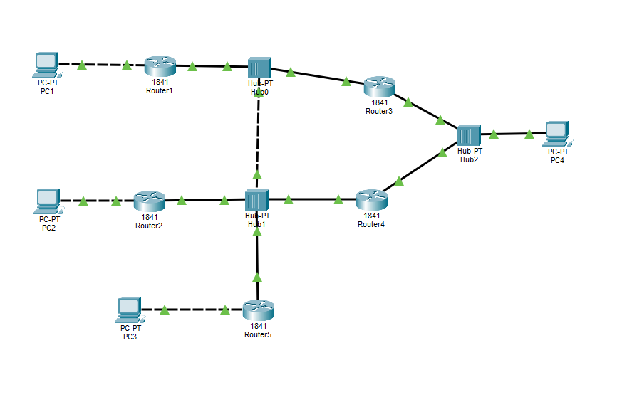

# Домашнее задание №8

Нужно было собрать в Cisco Packet Tracer две схемы для дальнейшей настройки маршрутизации.

## Статическая маршрутизация

[Файл Packet Tracer](pkt/Статическая-маршрутизация.pkt)

## RIP

[Файл Packet Tracer](pkt/Сеть-для-настройки-RIP.pkt)
